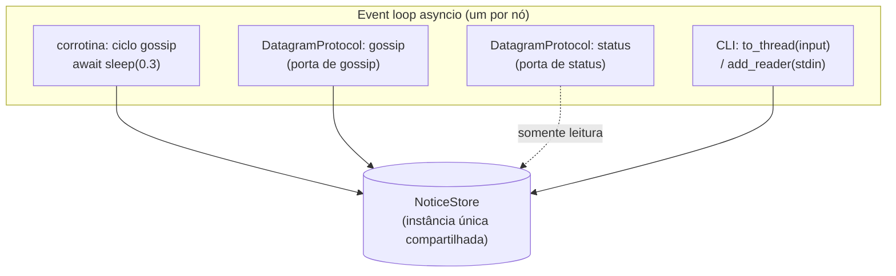
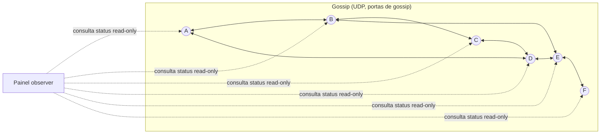

# design.md — Mural Distribuído com Gossip Push-Pull (Anti-Entropia)

> Grupo 7 — Autores: Albano Mendes, Gustavo Cunha, Arthur Bastos.

## 1. Problema

Implementar um mural de avisos replicado entre seis processos independentes (A–F). Um aviso criado em qualquer processo deve se espalhar pelos demais sem servidor central. Cada processo mantém seu conjunto de avisos em memória; durante a propagação os conjuntos divergem, mas após trocas suficientes os processos ativos convergem para o mesmo conjunto, desde que a comunicação permita. O objetivo é **demonstrar o protocolo gossip push-pull (anti-entropia)**, não construir um sistema de mensagens completo.

## 2. Ideia da solução

Cada nó executa duas atividades concorrentes, exatamente o modelo de Kermarrec & van Steen (thread ativa + thread passiva):

- **Thread ativa (iniciador):** a cada ~300 ms, seleciona 2 pares uniformemente ao acaso e, para cada um, envia um `GOSSIP` com seu conjunto completo de avisos (push), depois incorpora o `REPLY` recebido (pull).
- **Thread passiva (receptor):** ao receber um `GOSSIP`, incorpora os avisos recebidos e responde com `REPLY` contendo seu próprio conjunto.

A troca é portanto **bidirecional**: após um `GOSSIP` → `REPLY` bem-sucedido, iniciador e par ficam com a **união** dos dois conjuntos. É a variante **anti-entropia (SI)**: a troca é periódica, o conjunto completo é enviado, não há marcação de "removido" e o processo continua indefinidamente.

Cada processo é iniciado com um identificador próprio via argumento de linha de comando, ex.: `--id A`, e carrega `config/` contendo endereços e portas (gossip e status) de **todos** os membros A–F. O ID próprio determina (a) a `origem` dos avisos criados localmente e (b) a exclusão de *self* na seleção de pares. A lista de membros menos o próprio ID forma o conjunto dos 5 pares elegíveis.

### Por que push-pull (desvio do Albano_Design.md)

O `Albano_Design.md` descreve envio apenas push e lista push-pull como fora de escopo. Adotamos push-pull por fundamentação acadêmica:

- **Gossip_Medium:** "The push-pull model is optimal to disseminate update messages quickly and reliably. [...] The push approach is efficient during the initial phase [...]; the pull approach is efficient during the final phase."
- **Kermarrec & van Steen:** o modelo geral de gossip é a troca bidirecional (P envia a Q, Q retorna a P); "a combination of the two [push and pull] is also possible".
- **Efeito prático:** uma única troca repara diferenças nos **dois** sentidos, acelerando a convergência e aumentando a robustez a perdas — ideal para uma demo curta e dinâmica.

## 3. Modelo de dados

Avisos pequenos e **imutáveis**:

```
id:       A:1          # "<origem>:<contador>"
origem:   A
contador: 1
texto:    "Apresentação do seminário às 10h."
```

- O próximo aviso de A é `A:2`; um aviso de B pode ser `B:1`.
- Sem edição nem exclusão — mantém o foco na disseminação, sem resolução de conflitos.

**Estado local de um nó:** um mapa `id → aviso` (dicionário), garantindo deduplicação natural por chave.

**Regra de incorporação (merge):**
```
para cada aviso recebido:
    se aviso.id ∉ estado_local:  estado_local[aviso.id] = aviso
    senão:                       ignora (duplicata)
```
A operação é comutativa, associativa e idempotente (união de conjuntos) — base formal da consistência eventual.

## 4. Operação do protocolo

### 4.1 Formato de mensagem (JSON sobre UDP)

```json
{
  "type": "GOSSIP",            // ou "REPLY"
  "sender": "A",               // id do remetente
  "notices": [
    { "id": "A:1", "origem": "A", "contador": 1, "texto": "..." }
  ]
}
```

Mensagens de status (porta de status dedicada, separada do gossip):

```json
// Consulta do painel para um nó:
{ "type": "STATUS_REQUEST", "sender": "panel" }

// Resposta do nó (apenas a lista de ids conhecidos basta ao painel):
{ "type": "STATUS_REPLY", "sender": "A", "notices": ["A:1", "B:1"] }
```

- `GOSSIP`: inicia uma troca; carrega o conjunto completo do iniciador.
- `REPLY`: resposta do receptor; carrega o conjunto completo do receptor.
- `STATUS_*`: não carregam o texto dos avisos, apenas seus `id`s.
- Mensagens malformadas são descartadas sem derrubar o processo (RF-04.3).

### 4.2 Ciclo push-pull (por ciclo de ~300 ms, fanout=2)

```
a cada INTERVALO:
    pares = seleciona_2_distintos(outros_5)        # uniforme, sem self
    para cada par em pares:                         # 2 trocas independentes
        envia GOSSIP(sender=eu, notices=estado)  → par   # sujeito a perda
# recepção é assíncrona (thread passiva):
ao receber GOSSIP de P:
    merge(notices)
    envia REPLY(sender=eu, notices=estado) → P          # sujeito a perda
ao receber REPLY de Q:
    merge(notices)
```

### 4.3 Diagrama de sequência (push-pull com fanout=2)

```mermaid
sequenceDiagram
    participant A as Nó A (iniciador)
    participant B as Nó B (par 1)
    participant C as Nó C (par 2)
    Note over A: Timer dispara (~300 ms)<br/>seleciona 2 pares distintos: B, C

    rect rgb(235,245,255)
    Note over A,B: Troca push-pull 1
    A->>B: GOSSIP {sender:A, notices: estado(A)}
    Note over B: merge(estado A) no estado local
    B-->>A: REPLY {sender:B, notices: estado(B)}
    Note over A: merge(estado B) no estado local
    end

    rect rgb(235,255,240)
    Note over A,C: Troca push-pull 2 (independente)
    A->>C: GOSSIP {sender:A, notices: estado(A)}
    Note over C: merge(estado A)
    C-->>A: REPLY {sender:C, notices: estado(C)}
    Note over A: merge(estado C)
    end

    Note over A,C: Qualquer GOSSIP/REPLY pode ser<br/>descartado por perda simulada;<br/>trocas futuras reparam diferenças.
```

### 4.4 Seleção de pares

`random.sample(outros_5, 2)` — 2 pares distintos, uniformes, nunca o próprio nó (RF-06). Pares parados podem ser escolhidos (sem detector de falhas); o `GOSSIP` simplesmente não terá `REPLY`, o que é inofensivo.

### 4.5 Modelo de concorrência (asyncio)

Cada nó roda sobre um **único event loop asyncio**, o que elimina condições de corrida sobre o `NoticeStore` (toda mutação ocorre no mesmo loop) e simplifica a CLI não bloqueante (RF-10.3). Componentes:

- **Ciclo periódico de gossip:** uma corrotina em laço com `await asyncio.sleep(0.3)` (intervalo configurável); a cada iteração seleciona 2 pares e dispara os 2 `GOSSIP`.
- **Recepção de gossip:** um `asyncio.DatagramProtocol` ligado à porta de gossip, que trata `GOSSIP` (merge + envia `REPLY`) e `REPLY` (merge).
- **Servidor de status:** um `asyncio.DatagramProtocol` **separado**, ligado à porta de status, que responde `STATUS_REQUEST` com `STATUS_REPLY` (lista de ids). Isolá-lo do protocolo de gossip garante que a observação seja somente leitura e não interfira na replicação.
- **CLI não bloqueante:** leitura de `stdin` via `asyncio.to_thread(input)` (ou `loop.add_reader(sys.stdin, ...)`), de modo que aguardar comandos nunca bloqueie o event loop nem os ciclos de gossip.



## 5. Falhas e garantias

### 5.1 Modelo de falha: fail-stop + perda de mensagens

- **Fail-stop:** um processo pode ser encerrado (Ctrl+C/sinal) e **não** se recupera; estado só em memória, sem persistência (RF-08). Não há detector de falhas — alinhado à abordagem "implícita" descrita em Kermarrec & van Steen, mas aqui nem removemos o par da lista (membership fixo).
- **Perda de mensagens:** probabilidade configurável de descarte no envio, aplicável a `GOSSIP` ou `REPLY` (RF-07). Sem ACK por aviso e sem retransmissão dirigida; a reparação vem das trocas periódicas e dos múltiplos caminhos (fanout + redundância), exatamente a "proactive approach to recovery by ensuring a priori a high degree of redundancy" de Kermarrec & van Steen.

Com N=6 e avisos pequenos, o JSON do conjunto completo cabe folgadamente em um único datagrama UDP (≪ 1500 bytes de MTU típica). Portanto não há fragmentação em nível de aplicação nem *chunking*; cada `GOSSIP`/`REPLY` é um datagrama único.

### 5.2 Garantia: consistência eventual

ENQUANTO cessarem novas inserções, houver comunicação suficiente e ao menos um nó ativo retiver cada aviso, todos os nós ativos convergem para o mesmo conjunto (RF-09). Não há promessa de prazo fixo nem de entrega sob qualquer condição de rede. Fundamento: o merge é união idempotente (reduz a entropia entre réplicas — "reducing the entropy of the entire system", Kermarrec & van Steen; "reduce the entropy between replicas", Gossip_Medium) e a disseminação epidêmica atinge todos os nós em O(log N) rounds com alta probabilidade.

## 6. Visualização da demonstração

Logs por evento (RF-11):
```
[A] CRIADO aviso=A:1
[A] ENVIADO tipo=GOSSIP destino=B avisos=1
[B] NOVO aviso=A:1 recebido_de=A
[B] ENVIADO tipo=REPLY destino=A avisos=2
[A] DESCARTE_SIMULADO tipo=GOSSIP destino=C
```

Painel textual (observer, RF-12) — consulta cada nó por uma **porta de status dedicada (somente leitura)**:
```
Aviso: A:1
  Nó   Conhece?    (F: indisponível)
  A    SIM
  B    SIM
  C    NÃO
  D    SIM
  E    NÃO
  F    (indisponível)
Cobertura observada: 3 de 5 nós ativos
```
O painel não distribui avisos, não escolhe pares e não participa da replicação; se ele parar, o gossip continua (RF-12.4). O painel usa um **timeout curto por consulta** (ex.: 200 ms). Se um nó não responder dentro do timeout, o painel o exibe como `(indisponível)` e segue para os demais, sem bloquear nem encerrar (RF-12.5). A cobertura é reportada sobre os nós ativos (que responderam).



## 7. Arquitetura e módulos

```
projeto_gossip/
├── src/
│   ├── aplicacao/      # Node startup, non-blocking stdin CLI (`post <text>`)
│   ├── estado/         # Notice model, local store, dedup/merge
│   ├── gossip/         # Periodic cycle, peer selection (fanout=2)
│   ├── comunicacao/    # UDP transport, JSON (de)serialization, simulated loss
│   └── monitoramento/  # Logging + observer panel (read-only status client)
├── config/             # Members, addresses, gossip/status ports, params
├── scripts/            # Start/stop demo
├── testes/             # Unit + scenario tests
└── docs/               # requirements.md, design.md, tasks.md, slides
```

Responsabilidades (coesão para testabilidade — RNF-04):
- **estado**: `Notice`, `NoticeStore` (merge idempotente, dedup) — puro, sem rede.
- **gossip**: `PeerSelector` (fanout=2, uniforme, sem self), `GossipEngine` (orquestra o ciclo).
- **comunicacao**: `UdpTransport` (send/recv), `codec` (JSON), `LossSimulator` (decisão de descarte) — injetável para testes.
- **monitoramento**: `logger`, `StatusServer` (responde estado por UDP), `Panel` (cliente read-only).
- **aplicacao**: `Node` (compõe tudo), CLI não bloqueante.

O `Node` cria **uma única instância** de `NoticeStore` e a injeta tanto no `GossipEngine` quanto no `StatusServer`, garantindo que gossip e observação enxerguem o mesmo estado. A CLI roda em thread separada via `asyncio.to_thread(input)` (ou `loop.add_reader`) para não bloquear o event loop; como toda mutação do store é agendada no loop, não há acesso concorrente real ao estado.

## 8. Simplificações (e o que fica de fora)

- **Membership completo** em vez de *partial views* / *peer sampling* (Newscast, Cyclon) — permitido pelo enunciado; com N=6 não há ganho de escala relevante.
- **Conjunto completo** em cada troca, sem **digests/hashes/Merkle trees** nem **Scuttlebutt** — volume pequeno dispensa otimização de banda.
- **Apenas SI (anti-entropia)**, sem **SIR (rumor-mongering)** nem **tombstones** — não há "esquecimento" de avisos nem término por rounds.
- Sem detector de falhas, ACK por aviso, persistência, edição/exclusão, consenso/eleição, criptografia, GUI/web.

## 9. Condições e limitações

Processos não maliciosos (sem BFT); mensagens podem ser perdidas; processos podem parar. Convergência esperada quando: ao menos um nó ativo retém cada aviso, os nós ativos se comunicam, as trocas periódicas continuam, e a seleção de pares e a entrega permitem o alcance. Não se promete entrega em prazo fixo; uma execução bem-sucedida demonstra o comportamento naquele cenário, não prova entrega sob qualquer rede. Observação de escala: o enunciado da banda/latência vale para N grande; aqui N=6 serve à didática, não à performance.
